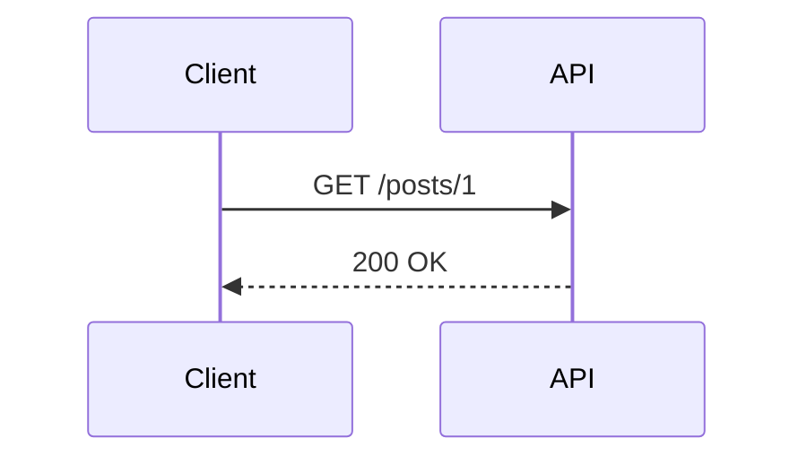

# 글에서 쓸 수 있는 표현

## 코드 블록 (Expressive Code)

````md
```ts title="src/lib/retry.ts" {3-5}
// title: 파일명 탭, {3-5}: 줄 강조
```

```diff lang="js"
- const res = await fetch(url);
+ const res = await fetch(url, { signal: AbortSignal.timeout(3000) });
```

```bash
npm run build
```
````

복사 버튼은 자동으로 붙고, 누르면 GA4 `code_copy` 이벤트가 전송된다. 언어 이름을 꼭 적는다 (GA에서 언어별 집계에 사용).

## Mermaid (정적 다이어그램)

시퀀스, 플로우, 상태, ER 다이어그램에 사용한다. `.md`, `.mdx` 모두 가능.

````md

````

## 수식 (KaTeX)

- 인라인: `$\frac{hits}{hits + misses}$`
- 블록:

```md
$$
\text{p99} = \inf \{ x : P(X \le x) \ge 0.99 \}
$$
```

## ServerFlow (움직이는 서버 통신 다이어그램) — `.mdx` 전용

파일 상단에 import (스크립트에 `--mdx`를 주면 자동으로 들어감):

```mdx
import ServerFlow from '../../components/diagrams/ServerFlow.astro';
```

```mdx
<ServerFlow
	caption="그림 1. 캐시 미스 시 요청 흐름"
	nodes={[
		{ id: 'client', label: 'Client', x: 0, y: 1, kind: 'client' },
		{ id: 'api', label: 'API Server', x: 1, y: 1 },
		{ id: 'redis', label: 'Redis', x: 2, y: 0, kind: 'cache' },
		{ id: 'db', label: 'PostgreSQL', x: 2, y: 2, kind: 'db' },
	]}
	edges={[
		{ from: 'client', to: 'api', label: 'HTTPS', response: true, packets: 2 },
		{ from: 'api', to: 'redis', label: 'GET', response: true, duration: 1 },
		{ from: 'api', to: 'db', label: 'SELECT', response: true, duration: 2.5 },
	]}
/>
```

- `nodes[].x, y`: 격자 좌표 (0부터). 가로 4칸 이내가 읽기 좋다.
- `nodes[].kind`: `client | server | db | cache | queue | external` (아이콘·테두리 색이 달라짐)
- `edges[]` 옵션:
  - `response: true` — 응답(초록 점)이 돌아옴
  - `duration` — 이동 시간(초). 느린 구간은 크게
  - `packets` — 동시에 흐르는 점 개수 (트래픽 양)
  - `dashed: true` — 비동기/이벤트 흐름 (큐, pub/sub)
  - `fail: true` — 빨간 점이 도중에 사라짐 (타임아웃, 실패)
- 정적인 순서 설명은 Mermaid, "흐름이 보여야 이해되는" 장면은 ServerFlow.

MDX 주의: 본문에 `{`, `}`, `<`가 그대로 있으면 문법 오류가 난다. 코드 블록이나 인라인 코드(`` ` ``) 안에 넣는다.

## 표, 인용

```md
| 지표 | 목표 |
| --- | --- |
| LCP | 2.5s 미만 |

> 인용문
```
