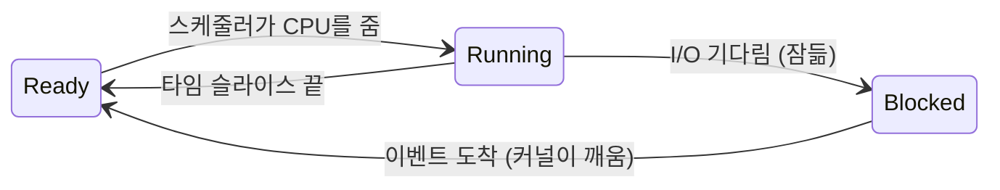
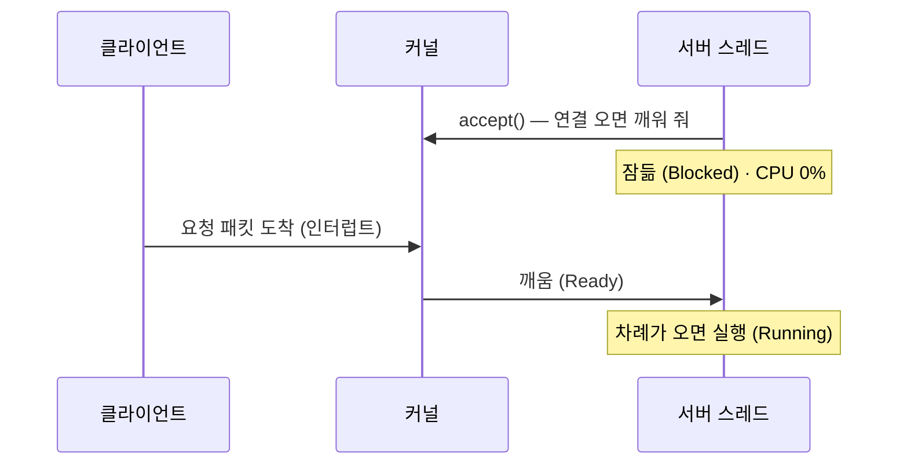

import LifecycleLayers from '../../components/diagrams/LifecycleLayers.astro';
import StartupFlow from '../../components/diagrams/StartupFlow.astro';
import RequestJourney from '../../components/diagrams/RequestJourney.astro';
import LayerRoles from '../../components/diagrams/LayerRoles.astro';
import FrameworkCompare from '../../components/diagrams/FrameworkCompare.astro';
import FlaskLayers from '../../components/diagrams/FlaskLayers.astro';
import ThreadMemory from '../../components/diagrams/ThreadMemory.astro';

백엔드를 공부하면서 늘 궁금했던 것이 있습니다. 서버가 "떠 있다"는 건 정확히 어떤 상태이고, 서버는 언제 요청을 받아서 언제 응답을 돌려주는 걸까요?

이 글에서는 운영체제에서 배운 내용으로 출발해서, 서버 프로세스가 요청을 기다리는 방식과 Spring Boot 서버가 켜지고 꺼질 때까지의 큰 흐름을 그림으로 정리합니다.

## 서버가 떠 있다는 건 무슨 뜻일까요?

저는 운영체제 시간에 배운 대로, 서버도 일종의 클럭(clock) 단위로 프로그램이 실행된다고 생각했습니다. 그렇다면 서버는 언제 요청 정보를 받아 오고, 언제 응답(response)을 보내는 걸까요?

먼저 운영체제부터 짚어 보겠습니다. CPU는 RAM에 올라간 여러 프로그램을 실제로는 하나씩 처리하지만, 아주 짧은 시간 단위로 번갈아 실행하기 때문에 동시에 많은 일을 처리하는 것처럼 보입니다.

- **다중프로그래밍**: 여러 프로그램을 RAM에 함께 올려 두고, 하나가 I/O를 기다리면 CPU를 다른 프로그램에 넘깁니다.
- **시분할**: 수 밀리초 단위로 번갈아 실행해서 동시에 도는 것처럼 보이게 합니다.

자바나 파이썬으로 만든 서버도 결국 RAM에 올라가는 프로그램입니다. `java -jar app.jar`를 실행하면 OS가 실제로 실행하는 건 `java`(JVM)이고, JVM이 우리 코드를 읽어 실행합니다. 파이썬은 `python` 인터프리터가 같은 역할을 합니다.

그렇다면 서버가 떠 있다는 건, 프로세스가 종료되지 않은 채로 포트를 listen 하면서 잠들어 있는 상태입니다. 여기서 잠들어 있다는 건 운영체제가 관리하는 스레드 상태 중 **Blocked(대기)** 상태를 말합니다. 스케줄러는 Ready 상태인 스레드에게만 CPU를 주기 때문에, Blocked 상태의 서버는 RAM에는 떠 있어도 CPU는 거의 쓰지 않습니다.



## 잠든 서버는 요청이 온 걸 어떻게 알까요?

처음에는 서버가 일정한 틱마다 "요청 왔나?" 하고 확인한다고 생각했습니다. 하지만 서버는 계속 확인하지 않습니다. 커널에 "요청이 오면 깨워 줘"라고 맡기고 잠듭니다.

커널은 스레드를 두 종류의 줄로 관리합니다.

- **실행 큐**: CPU를 받을 차례를 기다리는 스레드(Ready). 스케줄러는 여기서만 다음 실행 대상을 고릅니다.
- **대기 큐**: 무언가를 기다리는 스레드(Blocked). 소켓, 파일 같은 자원마다 하나씩 있습니다.

서버 스레드가 `accept()`를 호출했는데 아직 연결이 없으면, 커널은 이 스레드를 대기 큐로 옮깁니다. 요청 패킷이 도착하면 네트워크 카드가 인터럽트를 걸고, 커널이 기다리던 스레드를 다시 실행 큐로 옮깁니다. 서버를 깨우는 건 틱이 아니라 **이벤트**입니다.



서버 코드를 짜는 방식은 크게 두 가지로 나뉩니다.

| | 블로킹 (Spring MVC) | 이벤트 루프 (Node.js, WebFlux) |
|---|---|---|
| 스레드 하나가 기다리는 대상 | 소켓 1개 | 소켓 여러 개를 한꺼번에 |
| 요청과 스레드 | 요청 하나에 스레드 하나 | 스레드 몇 개가 많은 요청을 처리 |

이벤트 루프도 폴링 방식은 아닙니다. `epoll_wait` 같은 시스템 콜로 "이 중 하나라도 준비되면 깨워 줘"라고 맡기고 잠들기 때문에, 요청이 없을 때는 블로킹 방식과 똑같이 CPU를 거의 쓰지 않습니다.

## 라이프사이클은 하나가 아니었습니다

라이프사이클은 단순히 "시작과 끝"이 아니라, 그 사이에 거치는 단계들의 순서입니다. 각 단계에는 개발자가 코드를 끼워 넣을 수 있는 자리가 있는데, 이것을 훅(hook)이라고 합니다. 흐름은 프레임워크가 진행하고, 정해진 시점이 되면 프레임워크가 내 코드를 불러 주는 방식입니다.

처음에는 서버가 실행되면 "A 시작 → A 종료"처럼 하나의 라이프사이클만 있다고 생각했습니다. 그런데 크기가 다른 라이프사이클이 여러 겹으로 겹쳐 있었습니다.

- **애플리케이션**: 서버 실행부터 종료까지. 서버 실행당 한 번입니다.
- **Bean**: 스프링이 만들어 둔 객체가 생성되고 소멸될 때까지. 보통 서버와 함께 태어나고 함께 사라집니다.
- **요청**: 요청 하나가 들어와서 응답이 나갈 때까지. 서버가 떠 있는 동안 계속 반복됩니다.

<LifecycleLayers caption="그림. 세 시기(준비·영업·마감)와 세 층의 라이프사이클" />

이 그림처럼 Spring Boot 서버는 **준비 → 영업 → 마감** 세 시기를 지납니다. 준비와 마감은 한 번씩, 영업은 요청이 올 때마다 반복됩니다.

## 준비: 서버를 켜면 스프링은 무엇을 미리 해 둘까요?

준비 시기를 한 문장으로 말하면, **일할 객체를 미리 다 만들어 두고 문을 여는 것**입니다. 요청이 올 때마다 Controller나 Service 객체를 새로 만들지 않고, 준비 시기에 만든 객체를 계속 재사용합니다.

<StartupFlow caption="그림. 준비 시기의 큰 흐름과, 각 단계에서 나오는 개념" />

그림의 각 단계에서 나오는 개념을 짧게 정리하면 다음과 같습니다.

- **@Component**: `@Controller`, `@Service`, `@Repository`가 모두 여기에 속합니다. 스프링은 이 이름표를 보고 객체를 미리 만들어 둡니다.
- **Bean**: 이렇게 스프링이 만들어서 보관하는 객체입니다. 보관함은 ApplicationContext입니다.
- **DI(의존성 주입)**: Service가 Repository를 쓰려면, 직접 `new`로 만들지 않고 생성자에서 "필요하다"고 요청만 합니다. 그러면 스프링이 보관 중인 Bean을 넣어 줍니다.
- **훅**: `@PostConstruct`, `ApplicationRunner`처럼 준비 도중 정해진 시점에 내 코드를 불러 주는 자리입니다.

`@`가 붙어 있다고 모두 같은 역할은 아닙니다. 어떤 이름표가 클래스에 붙고 어떤 이름표가 메서드에 붙는지 헷갈린다면, 그 이름표가 **"누구"**에 대한 말인지 **"어떤 동작"**에 대한 말인지 물어보면 됩니다.

```java title="OrderController.java"
@RestController                     // "누구": 이 객체를 만들어 둬 → 클래스
public class OrderController {

    @GetMapping("/orders/{id}")     // "동작": 이 요청이 오면 나를 불러 → 메서드
    public OrderResponse get(Long id) { ... }
}
```

## 영업: 요청 하나는 어떤 길을 지나갈까요?

준비가 끝나면 서버는 잠든 채로 요청을 기다립니다. 요청이 오면 톰캣 워커 스레드 하나가 깨어나서, 바깥 상자부터 안쪽으로 들어갔다가 같은 상자들을 거꾸로 지나 응답을 내보냅니다.

<RequestJourney caption="그림. 요청 하나가 들어갔다가 나오는 길 (버튼으로 단계 이동)" />

처음에는 이 모든 단계가 훅으로 통신하는 거라고 생각했습니다. 하지만 누가 누구를 부르는지에 따라 세 가지로 나뉩니다.

| 누가 → 누구를 | 방식 |
|---|---|
| 스프링 → 내 코드 | 스프링이 정해진 때에 부름 (훅, URL에 맞는 Controller 메서드) |
| 내 코드 → 내 코드 | 일반 메서드 호출 (Controller → Service → Repository) |
| 내 프로세스 → 밖 | 네트워크 통신 (DB, 다른 서버) |

Controller, Service, Repository로 레이어를 나눠도 프로세스나 스레드가 나뉘지는 않습니다. 한 워커 스레드 안에서 이어지는 메서드 호출이고, 스레드가 잠드는 건 DB 응답을 기다릴 때뿐입니다.

## 요청이 오면 Controller, Service, Repository는 각각 무엇을 할까요?

세 레이어로 나누는 이유는 **바뀌는 이유가 다른 코드를 떨어뜨려 놓기 위해서**입니다. API 스펙이 바뀌면 Controller만, 비즈니스 규칙이 바뀌면 Service만, 저장 방식이 바뀌면 Repository만 고치면 되도록 나눕니다.

<LayerRoles caption="그림. 요청이 들어가고 응답이 나올 때 세 레이어가 맡는 일" />

그림에서 눈여겨볼 점은 세 가지입니다.

- **각 레이어가 몰라야 하는 것**이 있습니다. Service가 HTTP 상태 코드를 알거나, Controller에 `if (재고 == 0)` 같은 비즈니스 판단이 들어가면 경계가 무너진 것입니다.
- **데이터의 모양이 레이어마다 바뀝니다.** 밖에서 들어온 JSON은 DTO가 되고, DB에서 나온 행은 Entity가 됩니다. Entity를 그대로 응답으로 내보내지 않고 DTO로 바꾸는 이유는, 비밀번호 같은 필드가 노출되거나 DB 컬럼을 바꿀 때 API 스펙까지 바뀌는 일을 막기 위해서입니다.
- **트랜잭션은 Service에 둡니다.** "재고 차감 + 주문 저장"처럼 함께 성공하거나 함께 실패해야 하는 단위를 아는 곳이 Service이기 때문입니다.

```java title="OrderService.java"
@Service
public class OrderService {
    private final ProductRepository productRepository;   // DI로 받음
    private final OrderRepository orderRepository;

    // 생성자 생략

    @Transactional                                       // 여기서 트랜잭션 시작
    public OrderResponse order(OrderRequest req) {
        Product p = productRepository.findById(req.productId()).orElseThrow();
        p.decreaseStock(req.quantity());                 // 비즈니스 규칙
        Order saved = orderRepository.save(new Order(p, req.quantity()));
        return OrderResponse.from(saved);                // Entity → DTO
    }                                                    // 끝나면 커밋, 예외면 둘 다 롤백
}
```

## 여러 스레드는 무엇을 함께 쓸까요?

요청마다 워커 스레드가 하나씩 붙는다면, 동시에 들어온 요청들은 같은 메모리를 어떻게 쓰고 있을까요?

한 프로세스 안의 스레드들은 코드, static 영역, 힙을 함께 씁니다. 스레드마다 따로 갖는 건 **스택**뿐입니다. 스레드는 실행 흐름 하나이기 때문에, 각자 "어디까지 했는지"(호출 기록, 지역 변수)만 따로 기억하면 되고 나머지는 프로세스의 자원을 같이 씁니다.

<ThreadMemory caption="그림. 스레드마다 따로 갖는 건 진행 상황(스택)뿐이고, Bean이 있는 힙은 함께 씁니다" />

이 그림이 "Service 필드에 요청별 값을 두면 안 된다"는 말의 이유입니다. Bean은 힙에 하나만 있고 모든 워커 스레드가 함께 쓰기 때문에, 필드 값을 바꾸면 다른 요청과 섞입니다. 반대로 파라미터와 지역 변수는 스레드의 스택에 있어서 안전합니다.

그래서 정합성은 두 곳에서 따로 챙깁니다.

- **메모리의 상태**: 공유하는 상태를 만들지 않는 것이 기본입니다. 꼭 필요하면 `synchronized`, `AtomicInteger`, `ConcurrentHashMap` 같은 도구를 씁니다. 다만 이 방법은 한 프로세스 안에서만 통합니다.
- **DB의 상태**: `@Transactional`만으로는 두 요청이 같은 재고를 동시에 읽고 고치는 문제(갱신 손실)를 막지 못합니다. 조건부 `UPDATE`, 비관적 락(`SELECT ... FOR UPDATE`), 낙관적 락(`@Version`)처럼 DB가 동시 수정을 막도록 함께 씁니다.

## Flask는 같은 흐름을 어떻게 지날까요?

파이썬의 Flask로 만든 서버도 준비 → 영업 → 마감이라는 큰 흐름은 같습니다. 다른 점은 **스프링이 대신 해 주던 일을 Flask에서는 개발자가 직접 한다**는 것입니다.

<FrameworkCompare caption="그림. 같은 세 시기를 지나는 Spring Boot와 Flask" />

**준비**: Flask에는 컴포넌트 스캔도, Bean 보관함도, DI도 없습니다. 파이썬 모듈이 import될 때 위에서 아래로 코드가 실행되면서 앱 객체가 만들어지고, `@app.route`가 붙은 함수가 URL 표에 등록됩니다. Service나 Repository 객체도 개발자가 직접 만들어서 연결합니다.

**영업**: 요청이 오면 Flask는 **앱 컨텍스트**를 열고, 그 안에 **요청 컨텍스트**를 연 다음 훅과 view 함수를 차례로 실행합니다. 덕분에 `request`, `g` 같은 객체를 어디서든 "지금 처리 중인 요청의 것"으로 쓸 수 있습니다.

Flask의 라이프사이클도 세 겹입니다. 다만 가운데 층이 스프링과 다릅니다. 스프링에는 서버와 함께 오래 사는 Bean의 층이 있지만, Flask의 앱 컨텍스트는 요청마다 열리고 닫힙니다.

<FlaskLayers caption="그림. 워커 프로세스 위에서 요청마다 열리고 닫히는 Flask의 두 컨텍스트" />

```python title="app.py"
from flask import Flask, g
import time

app = Flask(__name__)                 # 준비: 앱 객체를 직접 만듦
repo = OrderRepository()              # 준비: 객체도 직접 만들고 직접 연결 (DI 없음)
service = OrderService(repo)

@app.before_request                   # 영업 훅: 모든 요청 전에
def start_timer():
    g.start = time.time()             # g: 이번 요청에서만 쓰는 저장소

@app.get("/orders/<int:order_id>")    # import될 때 URL 표에 등록
def get_order(order_id):              # Controller 역할
    return service.find(order_id)     # dict를 반환하면 JSON으로 바뀜

@app.teardown_request                 # 영업 훅: 예외가 나도 마지막에 실행
def cleanup(exc):
    ...
```

Flask는 Controller, Service, Repository 구조를 강제하지 않습니다. 위 코드처럼 view 함수가 Controller 역할을 하고, Service와 Repository는 개발자가 모듈로 나눠서 같은 구조를 직접 만듭니다.

**실행과 마감**: `flask run`은 개발용 서버입니다. 실제 운영에서는 gunicorn 같은 WSGI 서버가 Flask 앱을 실행합니다. gunicorn은 마스터 프로세스가 워커 프로세스 여러 개를 띄우고, 각 워커가 요청을 처리합니다. 종료 신호가 오면 gunicorn이 워커들에게 처리 중인 요청을 마무리하게 한 뒤 종료합니다. Flask 자체에는 `@PreDestroy` 같은 종료 훅이 없어서, 필요하면 gunicorn 쪽 설정을 씁니다.

## 정리

서버가 떠 있다는 건, 프로세스가 종료되지 않은 채 포트를 listen 하면서 대부분의 시간을 잠들어 있는 상태입니다. 서버를 깨우는 건 일정한 틱이 아니라 요청 도착 같은 이벤트입니다.

Spring Boot 서버는 이 위에서 세 시기를 지납니다. **준비** 시기에 일할 객체(Bean)를 미리 만들어 연결해 두고, **영업** 시기에는 요청이 올 때마다 그 객체들이 처리하며, **마감** 시기에는 처리 중인 요청만 마무리한 뒤 객체들을 정리하고 종료합니다(graceful shutdown).
